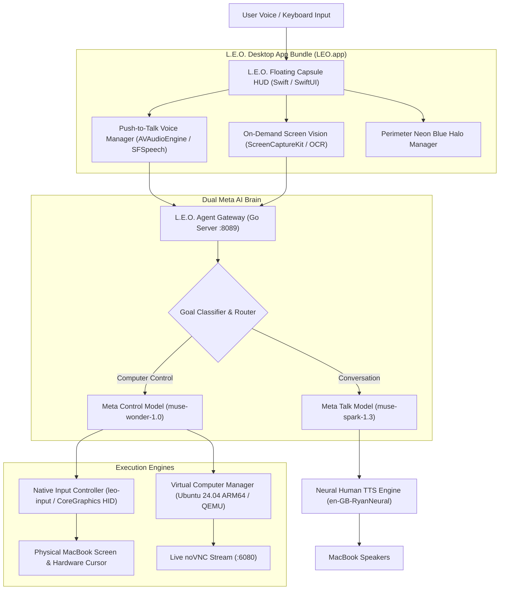

# 🦁 L.E.O. — Live Executive Operator for macOS

> **Autonomous, multi-model AI desktop companion for complete MacBook physical control, real-time conversational voice, computer vision, and an integrated Ubuntu virtual computer.**

[](https://apple.com)
[](https://swift.org)
[](https://go.dev)
[](https://meta.ai)
[](LICENSE)

---

## 🌟 Overview

**L.E.O.** (Live Executive Operator) unifies conversational AI, real-time computer vision, low-level CoreGraphics hardware automation, and virtual computing into a **single, cohesive macOS desktop application**.

Instead of fragmented scripts or robotic speech, L.E.O. provides:
- 🖱️ **Physical MacBook Mouse & Keyboard Control**: Direct CoreGraphics HID event posting with smooth bezier cursor glide, left/right/double/triple clicks, drag, scroll, and instant Unicode character typing.
- 🎙️ **Studio Neural Voice**: 100% natural British human voice (`en-GB-RyanNeural`) powered by neural text-to-speech. Zero robotic `/usr/bin/say`.
- 👁️ **On-Demand Computer Vision**: Instant single-frame screen perception analyzed by Apple Vision OCR and multimodal models, without continuous recording or persistent privacy indicators.
- 🖥️ **Built-in Ubuntu ARM64 Virtual Computer**: Dedicated containerized Linux environment with live noVNC desktop streaming for sandboxed agent tasks.
- 💊 **Floating Capsule HUD**: Minimalist `760×56 pt` top-center pill featuring an animated audio waveform visualizer, dynamic status pill, and neon blue perimeter screen halo.

---

## 🏗️ Architecture



---

## 🚀 Quick Start

### 1. Prerequisites
- **macOS**: Sonoma (14.0+) or Ventura (13.0+) on Apple Silicon (M1/M2/M3/M4) or Intel.
- **Tools**: Swift 5.10+, Go 1.22+, Python 3.10+ (for `edge-tts`).
- **Dependencies**:
  ```bash
  pip install edge-tts
  ```

### 2. Build L.E.O.
Build all binaries and package the unified `LEO.app` with one command:
```bash
./build_leo.sh
```

### 3. Run L.E.O.
Launch the application and start the background agent engine:
```bash
./run_leo.sh
```
- Toggle the floating capsule at any time with <kbd>⌥ Option</kbd> + <kbd>Space</kbd>.
- The agent gateway will be active and healthy at `http://127.0.0.1:8089`.

### 4. Stop Cleanly
Stop all L.E.O. processes and clear any audio/screen capture sessions:
```bash
./stop_leo.sh
```

### 5. Automated Verification Test Suite
Run the end-to-end self-test to verify cursor movement, window inspection, API responsiveness, and AI dispatch:
```bash
./test_leo.sh
```

---

## 🕹️ Direct MacBook Control Commands

You can speak to L.E.O. via Push-to-Talk (<kbd>Double-Tap Fn</kbd> or click the Mic button) or submit goals via the HUD text bar or REST API.

| Action Category | Example Command | What L.E.O. Does |
| :--- | :--- | :--- |
| **Mouse Cursor** | `"move mouse to center"` | Smoothly glides cursor to `(735, 478)` |
| | `"move cursor to top left"` | Moves cursor to `(100, 100)` |
| | `"move mouse to 500, 300"` | Moves cursor to exact pixel coordinates |
| **Mouse Clicks** | `"click"` or `"click mouse"` | Physical left click at current position |
| | `"double click"` | Rapid double click |
| | `"right click"` | Contextual right click |
| | `"triple click"` | Paragraph / line selection click |
| **Drag & Scroll** | `"drag from 100 100 to 600 400"` | Click and drag across the screen |
| | `"scroll down"` / `"scroll up"` | Scrolls document or page by 5 units |
| **Keyboard** | `"type 'Hello World'"` | Direct native Unicode text entry |
| | `"press cmd+space"` | Simulates macOS Spotlight shortcut |
| | `"press enter"` / `"press escape"` | Sends key events to active window |
| **Computer Vision** | `"look at my screen"` | One-shot silent capture, OCR extraction, AI spoken analysis |
| **Application Control** | `"open Safari"` / `"open Notes"` | Activates or launches native macOS application |
| | `"list windows"` | Inspects all open desktop windows and active PIDs |
| **Virtual Computer** | `"start computer"` | Boots the Ubuntu 24.04 ARM64 containerized VM |
| | `"run in computer ls -la"` | Executes terminal command inside the Linux sandbox |

---

## 🔒 Privacy & macOS TCC Compliance

In macOS Sonoma and Sequoia, aggressive background polling can trigger orange camera (screen capture) and microphone indicators in the menu bar.

L.E.O. guarantees **zero privacy indicator collision**:
1. **Push-to-Talk / On-Demand Microphone**:
   - The microphone is strictly muted by default.
   - When triggered, it captures your utterance, immediately stops `AVAudioEngine`, and uninstalls the mic tap.
   - **The microphone never auto-reopens while or after speaking.**
2. **Single-Frame Screen Perception**:
   - Screen vision captures **one single frame** via `ScreenCaptureKit` / `screencapture -x -t png` and immediately releases the display session.
   - Microphone capture is paused before any screen frame is inspected.
3. **No Flashing Indicators**:
   - Microphone and camera badges will **never** flash simultaneously or alternate in a loop.

---

## 🌐 API & Integration Endpoints

L.E.O. runs a local REST & WebSocket gateway on port `8089`:

### Submit an Autonomous Goal
```bash
curl -X POST http://127.0.0.1:8089/api/v1/tasks \
  -H "Content-Type: application/json" \
  -d '{
    "goal": "move mouse to center",
    "mode": "computer",
    "max_steps": 5
  }'
```

### Health Check
```bash
curl http://127.0.0.1:8089/api/v1/health
# Response: {"service":"MacPilotAI Agent Gateway","status":"healthy","version":"1.0.0"}
```

### Direct CLI Input Control
You can also invoke the native input controller directly from the terminal:
```bash
# Get screen resolution
./LEO.app/Contents/Resources/bin/leo-input dimensions

# Get cursor position
./LEO.app/Contents/Resources/bin/leo-input cursor

# Move cursor
./LEO.app/Contents/Resources/bin/leo-input move center
./LEO.app/Contents/Resources/bin/leo-input move 400 300

# Left click / Double click
./LEO.app/Contents/Resources/bin/leo-input click
./LEO.app/Contents/Resources/bin/leo-input double_click

# Type text via native Unicode injection
./LEO.app/Contents/Resources/bin/leo-input type "Hello from L.E.O."

# List open desktop windows
./LEO.app/Contents/Resources/bin/leo-input windows
```

---

## ⚙️ Configuration (`.env`)

Create a `.env` file at the root or within `MacPilotAI/.env`:

```env
# Meta AI Multi-Model Configuration
MUSE_API_KEY="your_api_key_here"
MUSE_ENDPOINT="https://api.meta.ai/v1/chat/completions"
MUSE_CONTROL_MODEL="muse-wonder-1.0"
MUSE_TALK_MODEL="muse-spark-1.3"

# Voice Settings
VOICE_NEURAL_VOICE="en-GB-RyanNeural"
VOICE_RATE="+0%"
VOICE_PITCH="+0Hz"

# Gateway & Ports
GATEWAY_PORT=8089
NOVNC_PORT=6080
```

---

## 🛠️ Repository Layout

```
.
├── LEO.app/                      # Unified macOS Application Bundle (Built via build_leo.sh)
├── MacPilotAI/
│   ├── apps/macos/               # Swift / SwiftUI Floating Capsule HUD & Managers
│   │   ├── App/                  # AppEnvironment, Lifecycle, Hotkeys
│   │   ├── Infrastructure/       # VoiceManager, ScreenVisionManager, BorderHalo
│   │   └── Presentation/         # ChatView, Waveform, Virtual Computer View
│   ├── packages/
│   │   └── input-controller/     # Native CoreGraphics HID Input Controller (main.swift)
│   ├── scripts/
│   │   ├── package_app.sh        # App assembly and codesigning
│   │   └── speak_human.sh        # Studio neural human TTS runner
│   └── services/agent-engine/    # Go Agent Engine (Gateway, Orchestrator, Meta AI Models)
├── build_leo.sh                  # One-command build script
├── run_leo.sh                    # One-command runner with health check
├── stop_leo.sh                   # Clean process shutdown
├── test_leo.sh                   # Automated verification test suite
└── README.md                     # Documentation
```

---

## 📄 License

Apache License 2.0. See [LICENSE](LICENSE) for details.
